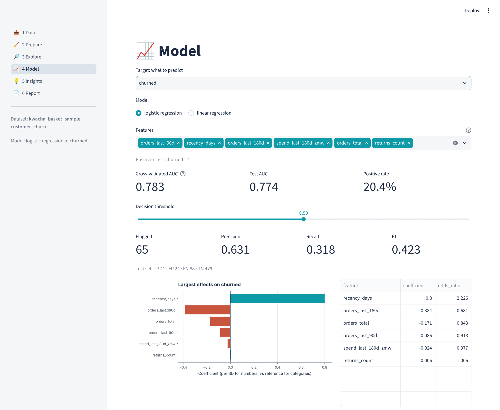

# AI-Enhanced Predictive Analytics Workspace

A six-page Streamlit app that takes a dataset from raw file to model to written recommendations:
**Data → Prepare → Explore → Model → Insights → Report**.

*Live app:* `https://<your-subdomain>.streamlit.app` · *Built for:* the capstone of
*Data Analysis for Beginners* (Chapter 15) · *Sample data:* Kwacha Basket, a fictional Zambian online retailer.



## What it does
- **Data** – upload a CSV (any encoding or delimiter) or a SQLite database; databases open read-only and accept one SELECT.
- **Prepare** – optional, logged cleaning steps; nothing changes without the user's choice.
- **Explore** – summary statistics and house-styled charts.
- **Model** – choose a target and features; linear or logistic regression with cross-validated and test metrics, and a live decision threshold.
- **Insights** – a language model turns the model's coefficients and metrics (never raw rows) into recommendations. Every number and feature it cites is checked against the model output, and the text is labelled as AI-generated.
- **Report** – download the analysis as HTML or Markdown.

## How it was tested
`python -m pytest tests` runs 10 tests: unit tests for the SQL guard, modelling (matching the book's
Chapter 12 results), insight validation and the report, and two end-to-end runs of all six pages with
Streamlit's AppTest, on the Kwacha Basket database and on a second dataset (fintech loans).

## Run it locally
```
pip install -r requirements.txt
streamlit run app.py
```
It runs offline with a mock language model. To use a live model, copy `.streamlit/secrets.toml.example`
to `.streamlit/secrets.toml` (or `.env`) and set `LLM_PROVIDER`, `LLM_MODEL` and one API key.

## Limitations
Models are linear or logistic regression only; coefficients are associations, not causes; the AI text is
a draft for a person to review.
